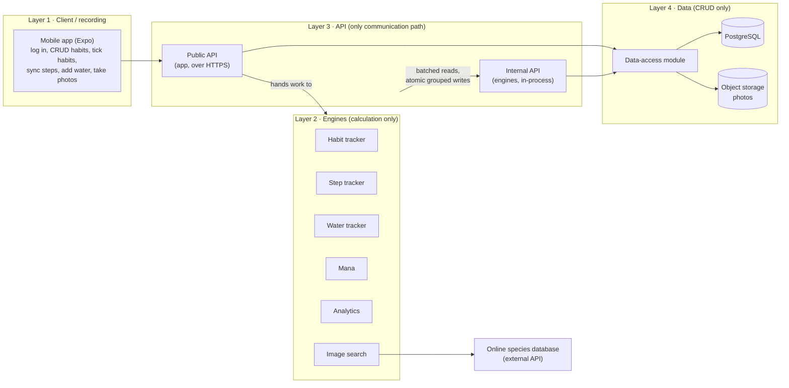
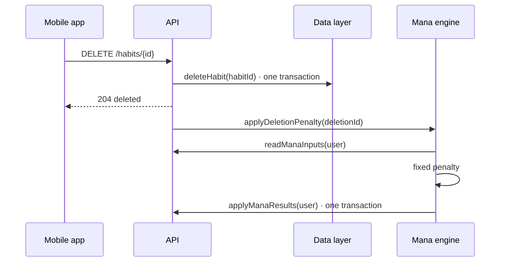
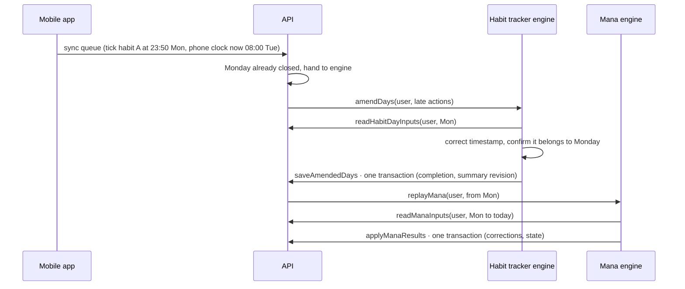
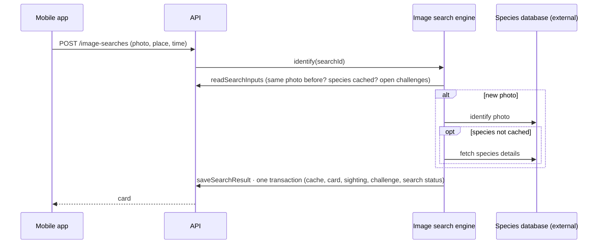
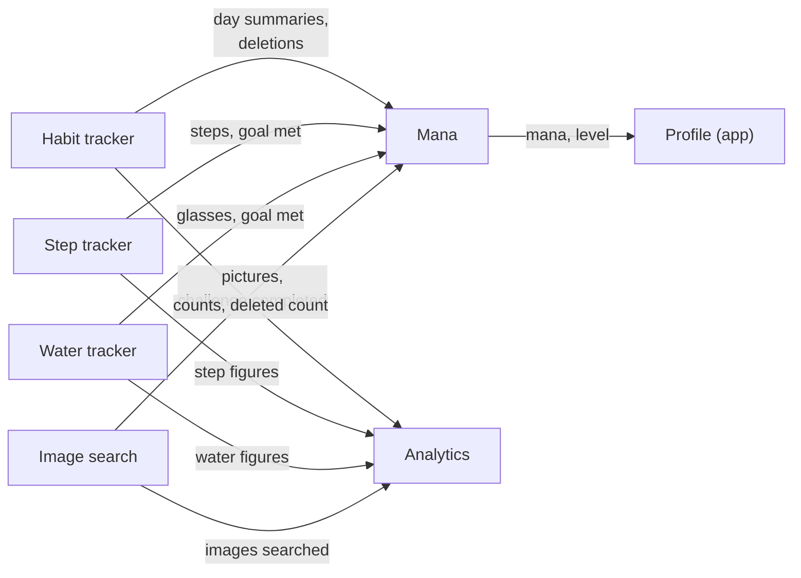
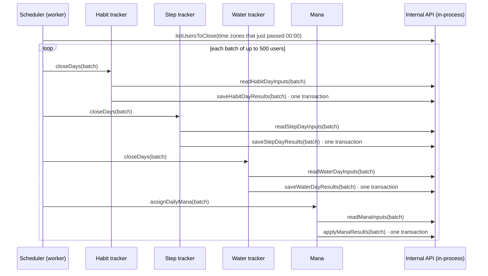

# Wildself — Backend Architecture

_As of 2026-11-24 · Stack approved · Phase 0 backend built in `services/backend`_

**Related docs:** [POA.md](POA.md) (plan and progress) · [FRONTEND.md](FRONTEND.md) (app) · [DB.md](DB.md) (database) · [IMPROVEMENTS_LOG.md](IMPROVEMENTS_LOG.md) (changes and instructions) · [metrics_and_testing.md](metrics_and_testing.md) (metrics, tests, reports)

The system has **4 strictly separated layers** and **6 engines**: Habit tracker, Step tracker, Water tracker, Mana, Analytics and Image search. The database layer only stores and retrieves. Engines only calculate. The internal API is the only path between engines and the database. Four efficiency rules (§6) keep this fast: atomic grouped writes, batches of users, counting in the database without deciding there, and in-process calls.

> **Status (2026-11-24):** stack approved (§8.1). Built so far:
>
> - **Layer 1:** the mobile app shell in `apps/mobile`, with the offline action queue (§3.4).
> - **Layer 3:** `services/backend` in two roles. The API has health checks, `/v1/session`, and the security rules of §3.6: request ids, security headers, rate and size limits, a safe error format, every route protected by default. The worker has a minute scheduler, a single-leader lock and a heartbeat. Plus the internal API (`packages/internal-api`) and shared contracts (`packages/contracts`).
> - **Layer 4:** `packages/data`, with the connection pool, health ping and leader lock.
> - **Engines:** none yet. The first one arrives in Phase 3.
>
> - **Testing (2026-11-24):**
>   - CI on GitHub runs every check on each push.
>   - A layer-boundary lint enforces §2 (dependency-cruiser).
>   - k6 load tests measured about 1,000 requests per second, clean, on one instance on a laptop.
>   - One security fix: the rate limit now runs **before** the login check, so callers without a login are limited by IP too (§3.6).
>
> Auth is an interface (`deny-all` by default, a local-only test login for development). **Supabase Auth was chosen on 2026-11-24** and is built in Phase 1 (§3.7, [AUTH.md](AUTH.md)). §11 lists what is still open.

---

## 1. The four layers



The app talks only to the public API. Engines read inputs from the internal API and send results back to it. Engines never call each other: one engine stores its results, and the next engine reads them. Only the API calls the data layer, and only the data layer touches PostgreSQL and object storage.

---

## 2. What each layer may and may not do

| Layer | Does | Never does |
| --- | --- | --- |
| **1 · Client / recording** (mobile app) | Captures user actions: sign-up, login, create / edit / delete habits, tick or untick, sync step counts from the phone's health data, add a glass of water, take or upload a photo, save a challenge. Shows results. Schedules phone reminders from data the API gives it. | Calculates mana, streaks, levels, schedules, goals or analytics. Talks to the database or engines directly. **One approved exception, for privacy:** rounds a photo's location to about 500 m and strips location data from the image file before upload, so the exact location never leaves the phone. |
| **2 · Engines** | Pure calculation. Read inputs and save results only through the internal API, in batches. Image search may call the external species API. | Import a database driver or the data layer. Contain SQL. Call another engine. |
| **3 · API** | Authenticates, authorises and validates. Routes requests to the data layer or hands work to an engine. Rejects changes to a closed day. | Calculates anything. |
| **4 · Data** | Stores and retrieves ([DB.md](DB.md)), including counts and sums (§6.3) and grouped writes in one transaction (§6.1). | Decides anything: no business rules, triggers, stored procedures or scheduled jobs. |

**Rule of thumb:** code that decides *how much*, *whether* or *what next* belongs in an engine. Code that moves data in or out of storage belongs in the data layer. The API connects the two and guards the door.

---

## 3. Recording flow (Layer 1, no engine involved)

### 3.1 Who does what for habits

| Action | Done by |
| --- | --- |
| Save a new habit, edit it, delete it | Recording: app → API → data layer |
| Check the input (title present, at least one day, window end after start) | API validation |
| Which habits are due today; closing each day; counts | Habit tracker engine |
| Daily mana; the fixed penalty on delete | Mana engine |
| Charts and totals | Analytics engine |

### 3.2 Ticking a habit

- Tapping the tick mark **or** the habit's name completes the habit for today; tapping again undoes it.
- Undo is possible until **23:59:59 local time**, measured by **when the tap happened on the phone**, not when it reaches the server. At 00:00 the day closes; a habit not ticked by then is recorded as incomplete.
- **Offline ticks count** (§3.4). A tick made at 23:50 with no signal keeps its phone timestamp and counts for that day whenever it arrives.
- A tap whose phone timestamp falls after the day ended cannot change that day.
- If the day is still open, the API saves the tick directly. If the day is already closed, the API hands the tick to the Habit tracker engine, which decides whether it belongs to that day (§3.4).

### 3.3 Deleting a habit

Deleted habits are removed from the database **immediately**, in **one atomic call**. In a single transaction, the data layer:

1. writes a small deletion record (enough to count deleted habits and to apply the penalty)
2. deletes the habit; its completions and per-habit day records go with it by cascade

The deletion record has no link to the habit, so the cascade leaves it in place. Past daily totals are frozen and stay unchanged. The Mana engine then applies a **fixed mana penalty**; the amount is decided when the Mana engine is built. If the habit was scheduled today, today's "all habits completed" no longer includes it.



**Proposed:** the delete confirmation shows the mana penalty before the user confirms, to support the app's aim of keeping habits.

### 3.4 Offline and late data

**Your rule:** no signal is not the user's fault, so nothing is lost. Every action counts for the moment it happened on the phone, whenever it reaches the server.

1. **Offline queue:** each tick, untick or glass of water is saved on the phone with its timestamp and a unique action id, and sent in order once the connection returns. The id makes resending safe: the same action is never saved twice.
2. **Wrong phone clocks:** with each send, the phone also sends its clock time at that moment, and the server records when it received it. The Habit tracker engine shifts the action's timestamp by the difference between the two clocks. A phone whose clock runs 10 minutes fast still has its 23:50 tick recorded at the true 23:50. This also blunts clock tampering, which would only work if the clock were changed between the tick and the send.
3. **Arriving after the day closed:** the day was closed at 00:00 with what the server had. When a late action arrives for that day, the Habit tracker engine **amends** the day: it saves the action and writes a new revision of the day summary. The Mana engine then **replays** mana from that day forward, because one day's streak changes every later day's multiplier, and records the difference as **correction** transactions. The mana ledger stays append-only, so every change can be traced.
4. **Sync window:** late actions are accepted up to **7 days** after the day they belong to. That covers long trips without signal and limits how far mana is replayed.
5. **The user is told:** when a late sync restores a streak or mana, the app shows a calm note, e.g. "Monday's habits synced. Your streak continues."

**Example:** on Monday the user ticks their last habit at 23:50 on a mountain with no signal. At 00:00 Monday closes as "2 of 3" and the streak breaks. At 08:00 on Tuesday the phone reconnects and the tick arrives. Monday is amended to "3 of 3", Monday's mana is recalculated, a correction is credited, and the streak continues as if the signal had never dropped.



### 3.5 Batched sync (Phase 3) and its security rules

When the signal returns, the phone sends **all waiting actions in one request** (`POST /sync`) instead of one request per action. You approved this on 2026-11-24 on the condition that it causes no security issues, so it follows these rules:

| Risk | Rule |
| --- | --- |
| Acting as someone else | The user is taken **only** from the verified login token, never from the request body. Every action is checked to belong to that user (e.g. the habit must be theirs) |
| Oversized or flooding requests | At most 100 actions and 256 KB per request; per-user rate limit; larger queues are sent in several requests |
| Malformed or unexpected data | Every action is validated against a strict schema for its type; unknown types or extra fields are rejected |
| Replayed requests | Each action's `client_action_id` is unique per user in the database, so replaying a request stores nothing twice |
| Back- or forward-dated actions | The corrected timestamp must fall inside the 7-day late-data window and not in the future; otherwise that action is rejected |
| Partial failures hidden | The reply lists every action with its own result: `accepted`, `duplicate` or `rejected` with a reason code. Nothing is dropped silently, and the phone keeps rejected actions visible |
| One bad action blocking the rest | Each action is applied in its own transaction; a rejected action never blocks the others |

### 3.6 Security first (rule set 2026-11-24)

Security is a priority in every phase, not a final audit.

- **Every request is authenticated** except the health checks; authorisation is checked per resource, so users can only ever touch their own data.
- **Validate everything that comes in** with strict schemas; reject unknown fields.
- **Parameterised SQL only**; no SQL built from strings.
- **Secrets only in environment variables**, never in code or git; the server refuses to start if a required secret is missing or a development-only setting is on in production.
- **Errors never leak internals**: users get an error code and a request id; details go to the logs and Sentry.
- **Limits everywhere**: request size, rate limits per user and per IP, query timeouts. Access control runs in this order, before the body is read: identify the caller from the token → apply the rate limit (per user, or per IP without a login) → refuse callers without a login. Limiting before refusing means token guessing and route probing are limited too (security fix from Phase 0 testing).
- **Security headers** on every response; HTTPS only in staging and production.
- **Dependencies** checked by `npm audit` in CI; reviewed before adding.
- **Every phase's testing stage includes security checks** for the endpoints it adds (access to another user's data, malformed input, limits).

### 3.7 Sign-in (decided 2026-11-24, built in Phase 1)

Full plan and setup steps: [AUTH.md](AUTH.md).

- **Supabase Auth** handles sign-in only: Apple, Google and email. Passwords, emails and Apple or Google identities live there, never in our database.
- The phone sends Supabase's short-lived access token to our API. Our `supabase` authenticator verifies it **locally** with Supabase's public keys (ES256 only; issuer, audience, expiry checked), cached, so there is no call to Supabase per request.
- The user id is the token's `sub`. It is also the primary key of our `users` table.
- The Supabase secret key lives only on the server and is used only to delete an account. Account deletion removes our data first, then the Supabase user, and is safe to repeat.
- `dev-stub` stays for local work and tests; production refuses it, and refuses to start without the Supabase settings.

---

## 4. The six engines

### 4.1 Habit tracker engine

**Your rules:**

| Rule | Detail |
| --- | --- |
| Schedules | All days · all days except Sunday · custom days of the week |
| Time window | Optional start and end time per habit |
| Reminders | When the window starts, and when it ends ("mark it completed") |
| End-of-day reminder | On by default |
| Home list | A habit appears only on its scheduled days |
| Day close | At 00:00 local; mana is assigned after that, not at the moment of the tick |
| Deletion | Immediate; counted in Analytics; fixed mana penalty |
| Missed days | A day not logged is **missed**, never skipped. Habits are ultimate. Only a ticket (§4.8) can cover a day |
| Time zone | The phone's **current** time zone, so the user's day follows them when they travel |
| Dormant users | After 14 days without opening the app, the midnight pipeline pauses for them. When they return, every day in between is closed as missed, in one batch |

**One schedule model (proposed):** every habit stores a set of weekdays. "All days" (Mon–Sun) and "except Sunday" (Mon–Sat) are presets. One formula then covers all three cases:

```text
completion rate for a period = completions on scheduled days ÷ scheduled days in the period
```

| Habit schedule | Scheduled days per week | Scheduled days in November 2026 |
| --- | --- | --- |
| All days | 7 | 30 |
| All days except Sunday | 6 | 25 |
| Custom: Mon, Wed, Fri | 3 | 13 |

**What it calculates:**

1. **Today's habits** per user, served to Home. The app caches the next 7 days so the list works offline and switches at midnight.
2. **Day close at 00:00 local:** which habits were scheduled and which completed. Saves the day summary and one record per habit, then the day is frozen and is never rewritten by later edits or deletions.
3. **Daily, weekly and monthly counts** per habit and in total, for Analytics.
4. **Amending closed days** when offline actions arrive late (§3.4).
5. **Reminder plan** for the app: start and end reminders on scheduled days, plus the end-of-day reminder. After each tick, the API returns whether any habit is still open today, so the app can skip the end-of-day reminder once everything is done.

**Reminders (proposed):** local notifications scheduled on the phone (expo-notifications). They fire on time, work without signal and need no push server.

### 4.2 Step tracker engine

**Decided (2026-11-23): track both all-day steps and walks.**

The phone already counts every step, with timestamps, in Apple HealthKit or Android Health Connect, even when our app is closed. Our app never records steps live; it reads them from the phone.

| | All-day steps | Walks |
| --- | --- | --- |
| What | Every step the phone counted that day | Intentional sessions: the user taps a small Start / Stop button on the Steps tile |
| Shown | Steps tile on Home; used for the step goal | Walk history; Nature calendar ("a particularly long walk") |
| Sent | Daily total, synced during the same day | Start and stop times, plus step counts in 5-minute blocks inside the walk |

**Forgotten Stop:** the engine ends a walk at the last step before **20 minutes without steps**. A walk lasts at most **4 hours** and is split at midnight. Steps taken after the walk really ended never count toward it. No GPS is recorded.

**Late data:** steps carry their own timestamps, so data that arrives late follows the same amend-and-replay rule as offline ticks (§3.4).

**What it calculates:**

1. **Day close at 00:00 local:** that day's steps, whether the goal was met, and BMI-based figures (distance, rough calories).
2. **Walk trimming:** the real end of each walk, and its steps and duration.
3. Daily, weekly and monthly step and walk figures for Analytics.
4. The **Steps** tile values on Home.

**How steps feed mana** (goal met, walks, a general step multiplier with no goal) is decided together with the Mana engine.

### 4.3 Water tracker engine

**Input:** glasses added by the user (tap the Water tile or its + button), recorded through the API. Optional daily goal.

**What it calculates:**

1. **Day close at 00:00 local:** glasses that day, and whether the goal was met.
2. Daily, weekly and monthly water figures for Analytics.
3. The **Water** tile values on Home.

The full water rules are still to come from you.

### 4.4 Mana engine

The most complex engine. It is planned and built together with the step and water trackers, because steps and water feed it.

| Rule | Value |
| --- | --- |
| Base mana | 1 point per day, only if **all habits scheduled that day** were completed |
| Streak | Daily: consecutive days on which all scheduled habits were completed. **A streak needs at least 2 days.** A day not logged is missed and breaks it |
| Multiplier | +0.25 for every day the streak is kept, **starting on day 3** (days 1 and 2 form the streak) |
| Multiplier limits (to design) | Not permanent: it rises only up to a limit and then resets. It also resets when the user adds a new habit. To be designed with you so users clearly understand how to earn more mana and progress |
| Reset | Multiplier back to **0** if even one scheduled habit is missed |
| When | **00:00 local**, after the Habit, Step and Water engines close the day |
| Habit deleted | **Fixed penalty**, amount decided when the engine is built |
| Late offline data | Replays mana from the amended day forward; differences recorded as correction transactions (§3.4) |
| Tickets | Mana can be spent on tickets that cover days of travel or days when habits are not feasible. A ticket replaces a missed day: the streak continues and the multiplier is **not** reset (§4.8) |
| Steps and water | Inputs to mana; rules to be decided together |
| Daily challenge | Extra mana (amount later); not completing it changes nothing |
| Pictures and learning | Inputs; month-end bonus for image searches and things learned |

**Inputs:** day summaries from the Habit, Step and Water engines, current mana state, pending deletion penalties, completed challenges, monthly image searches and learning records, level thresholds.

**Outputs:** mana transactions and the updated mana state (streak, multiplier, total, level), saved together in one atomic call. Mana and level are shown in Profile.

### 4.5 Analytics engine

**Sources:**

1. **Habits** (from the Habit tracker engine): habits created, habits deleted, how regularly each is followed.
2. **Images searched:** every image run through the Image search engine, as its own collection.
3. **Steps and water** (from the Step and Water tracker engines).

**Habit analytics:**

| View | What it shows |
| --- | --- |
| Day | Text only: e.g. "2 of 3 habits completed today" |
| Week | Bar chart: habits on the X axis, times completed on the Y axis |
| Month | Same bar chart for the month |
| Totals | Scheduled vs completed across all habits for the day, week and month |
| Deleted habits | Number deleted in the period |

Totals always count against each habit's **scheduled** days. **Proposed:** each bar shows completed in front of a lighter bar for scheduled.

### 4.6 Image search engine

Takes a captured or uploaded picture, searches an online species database and returns a **card**. Species details are fetched once per species and reused. If the identified species matches the user's open daily challenge (today's or a saved one), the challenge is completed and the Mana engine adds the bonus. The photo joins the personal collection with its date and time.



### 4.7 Daily challenges: owner to decide

Picking one challenge a day from season and location is a calculation that none of the six engines owns yet. Options: part of the Image search engine, or a seventh Challenge engine (§11.2).

### 4.8 Ticket system (new, rules to be set)

**Your idea:** habits are ultimate, so a missed day is always missed. When a user can't follow their habits for a valid reason (travel, a day when it isn't feasible), they can **spend mana on tickets**. A ticket used on a day covers it, so it is not counted as missed.

**Proposed fit with the layers (no new engine needed):**

| Step | Done by |
| --- | --- |
| User asks to buy a ticket, or to use one on a date | Recording: app → API |
| Is there enough mana? Deduct the price | Mana engine (it owns the balance), one atomic write |
| Is the date allowed? | Mana engine, on the rules you set |
| Day close sees a ticket on that date → status **covered** instead of missed | Habit tracker engine |
| What a covered day does to the streak and multiplier | Mana engine, on the rules you set |

**Proposed:** mana has two counters: a **balance** that tickets spend, and **lifetime earned**, which sets the level. Buying a ticket then never makes a user lose a level. The rules are open in §11.8.

---

## 5. Engine dependencies and the midnight pipeline



Every arrow is a stored result passed through the API; engines never call each other.

**At midnight**, the worker runs the engines in a fixed order, **one batch of users at a time** (§6.2):



**Dormant users** (no app open for 14 days) are left out of the nightly run: `listUsersToClose` receives a cut-off date from the engine. When such a user opens the app again, the same pipeline runs once for them over the whole gap, closing every missed day as **missed** in one batch, before Home loads.

Analytics refreshes after the pipeline, or when the user opens the Analytics tab (§11.5).

---

## 6. Efficiency rules

These four rules keep the strict layers, and add no business logic to the database. Together they cut the midnight work by about 1,000×.

| | Calls to close one day |
| --- | --- |
| Before (one call per read or write, per user, 4 engines) | About 16 per user → **about 1.6 million** for 100,000 users |
| After (batches of 500, one read + one atomic write per engine) | 8 per batch → **about 1,600** for 100,000 users |

### 6.1 Atomic grouped writes

Each engine sends all of its results for a task in **one call**, and the data layer saves them in **one database transaction**: all succeed or nothing changes. This removes half-finished writes, such as a mana transaction saved without its updated total.

| Task | Saved together |
| --- | --- |
| `saveHabitDayResults` | Day summaries, per-habit day records, engine-run markers |
| `saveStepDayResults` / `saveWaterDayResults` | Day summaries, engine-run markers |
| `applyManaResults` | Mana transactions, mana states (with a version check), processed deletion penalties, engine-run markers |
| `deleteHabit` | Deletion record, then removal of the habit (its history follows by cascade) |
| `saveSearchResult` | Species cache, card, sighting, challenge completion, search status |

**Concurrency:** each mana state has a version number. A write succeeds only if the version is unchanged since it was read; otherwise the engine re-reads and recalculates. A deletion penalty arriving during the midnight run therefore can never overwrite it, or be overwritten by it.

### 6.2 Batches of users

Engines read inputs for a batch of users (proposed: 500) in one call and write results for the whole batch in one call.

- **Order:** batches run one after another, with limited parallelism (proposed: up to 4 at once), so the database is never flooded.
- **Target (proposed):** every user in a time zone is processed within 15 minutes of their midnight.
- **Failures:** if a batch's transaction fails, it is retried; if it fails again, the batch is split and retried per user, so one bad record cannot block 499 others. Engine-run markers with unique keys stop any day from being closed or credited twice.

### 6.3 The database counts but never decides

Data-layer queries may filter, join, group, count and sum. Engines decide what the numbers mean.

| Allowed in the data layer | Not allowed |
| --- | --- |
| "How many times was each habit completed between 1 and 30 November?" | "Did this user earn mana today?" |
| `WHERE`, `JOIN`, `GROUP BY`, `COUNT`, `SUM`, date ranges | Thresholds, mana constants, `CASE` statements encoding app rules |
| Keys, `UNIQUE`, `NOT NULL`: the last line of defence against double credits | Triggers, stored procedures, scheduled jobs |

### 6.4 Logical separation first, network separation only when needed

The internal API is one typed interface. At first, the engines call it **in the same process**, which takes microseconds instead of the milliseconds of an HTTP call. The layer boundaries are enforced by package structure and CI lint rules, not by network hops.

The same build runs in two roles:

| Role | Runs | Copies |
| --- | --- | --- |
| `api` | Public HTTPS API for the app; hands on-demand work (image search, deletion penalty) to engines in-process | As many as traffic needs |
| `worker` | Scheduler, midnight pipeline, all engines, internal API in-process | One active copy, so the midnight run happens exactly once |

If one engine ever needs its own server, the same internal API is served over HTTP with no change to engine logic.

---

## 7. API

| Group | Caller | Examples |
| --- | --- | --- |
| Public (HTTPS) | Mobile app, user token | `POST /auth/*` · `GET/POST /habits` · `PATCH/DELETE /habits/{id}` · `GET /today` (habits, challenge, tiles) · `PUT/DELETE /habits/{id}/completions/{date}` · `PUT /steps/{date}` (sync) · `POST /water/glasses` · `GET /reminders/plan` · `GET /challenges/{id}` · `PUT/DELETE /challenges/{id}/save` · `GET /profile` · `POST /image-searches` · `GET /analytics/habits?period=week\|month` |
| Internal (in-process) | Engines only | `listUsersToClose` · `readHabitDayInputs` / `saveHabitDayResults` · `saveAmendedDays` · `readStepDayInputs` / `saveStepDayResults` · `readWaterDayInputs` / `saveWaterDayResults` · `readManaInputs` / `applyManaResults` · `readSearchInputs` / `saveSearchResult` · `readAnalyticsInputs` / `saveAnalyticsResults` |

Every internal read takes a batch of users; every internal write is one transaction. Public endpoints are described in an OpenAPI contract; every write accepts an idempotency key.

---

## 8. Stack and repository layout

### 8.1 Stack (approved 2026-11-24)

Chosen for lowest running cost, speed, ease of building, no silent failures and few calls per feature.

| Concern | Choice |
| --- | --- |
| Mobile app | Expo (React Native, TypeScript); see [FRONTEND.md](FRONTEND.md) |
| Steps | react-native-health (iOS HealthKit), react-native-health-connect (Android) |
| Reminders | expo-notifications, local scheduled notifications |
| API and worker | Node.js 22 + TypeScript, **Fastify 5**, Zod validation; **one build, two roles** (`api`, `worker`) (§6.4) |
| Hosting | **Always-on small container** (Docker) at a low-cost host such as Fly.io, Railway or Render; picked by comparing current prices before Phase 0's deployment stage. Not serverless: no cold starts, no extra scheduler, queue or pooler services |
| Data layer | `packages/data`, SQL via `postgres.js` |
| Database | **Managed PostgreSQL** (e.g. Neon or Supabase-hosted Postgres) in staging and production; local PostgreSQL 17 in development |
| Migrations | Plain SQL files, forward-only, CI check against logic objects |
| Object storage | S3-compatible bucket for photos |
| Auth | **Supabase Auth** (decided 2026-11-24): sign-in only, tokens verified locally by our API with Supabase's public keys (§3.7, AUTH.md). Phase 0 has the authentication interface and a development-only stub that refuses to start in production |
| Testing | Vitest (engines, API, data layer on a real PostgreSQL), Maestro end-to-end, load test of the midnight pipeline |
| CI/CD | GitHub Actions; EAS Build / Submit / Update |
| Monitoring | Sentry (API and worker) with all personal-data collection switched off, Sentry Crons check-ins from the worker heartbeat, structured logs with request ids and redacted secrets, health endpoints (`/health`, `/health/ready`) with an uptime monitor, midnight completeness check |
| Single active worker | PostgreSQL session advisory lock held on a dedicated connection and verified before every tick; freed automatically if the worker dies |
| Build | esbuild bundles `services/backend` and our packages into one file (`dist/main.js`); third-party packages stay normal dependencies |
| Repository | GitHub, private: `chvsaditya-wq/Wildself`, branch `main` |

**Why not serverless** (decided 2026-11-24): a habit app is used every day and has a fixed midnight job, which is the case where an always-on server is cheapest and simplest. Serverless would add cold starts (felt as lag in the app), plus a scheduler, a queue and a connection pooler, each one more place to fail silently. The layered code does not depend on hosting, so it could move to serverless later if traffic patterns change.

### 8.2 Repository layout

```text
nature-app-project/
├── apps/mobile/              Layer 1 · Expo app
├── engines/                  Layer 2 · calculation only
│   ├── habit-tracker/
│   ├── step-tracker/
│   ├── water-tracker/
│   ├── mana/
│   ├── analytics/
│   └── image-search/
├── packages/
│   ├── internal-api/         Layer 3 · typed interface engines call (in-process)
│   ├── data/                 Layer 4 · CRUD functions (imported only by internal-api and services/api)
│   ├── contracts/            OpenAPI spec + shared types
│   └── api-client/           typed client for the app
├── services/
│   └── backend/              one build, two roles chosen at start-up:
│       ├── src/api/          role "api": public HTTPS endpoints
│       └── src/worker/       role "worker": scheduler + midnight pipeline
├── db/migrations/
└── docs/
```

### 8.3 How the separation is enforced

- **Import rules** (dependency-cruiser in CI): `engines/*` may import only the `internal-api` interface and `contracts`, never `packages/data`, a database driver or another engine. `apps/mobile` imports only `contracts` and `api-client`.
- **Migration check** in CI: no functions, procedures, triggers, rules or scheduled jobs ([DB.md](DB.md) §8).
- **Query review rule:** data-layer SQL may count and sum, never decide (§6.3).

---

## 9. Data

Tables, columns and every data-layer operation are in **[DB.md](DB.md)**.

---

## 10. Load test (planned)

Before launch, the midnight pipeline is load-tested with 100,000 simulated users in one time zone. It passes if every user is processed within the target window (§6.2), with no day closed twice and no mana credited twice.

---

## 11. Open questions

### 11.1 Answered (2026-11-23)

| Topic | Answer |
| --- | --- |
| Engines | 6: Habit tracker, Step tracker, Water tracker, Mana, Analytics, Image search |
| Efficiency | All four rules in §6 adopted |
| Day boundary | 00:00 local time |
| Undo a tick | Until 23:59 of the same day; after that, incomplete |
| When mana is assigned | At 00:00, after the day closes |
| Schedules | All days, all days except Sunday, or custom weekdays |
| Time windows | Optional; start and end reminders; end-of-day reminder on by default |
| Deleting a habit | Removed immediately; counted in Analytics; **fixed mana penalty** (amount later) |
| Mana planning | Planned and built together with the step and water trackers |
| Offline ticks | Count, using the time of the tap on the phone; late arrivals amend the closed day (§3.4) |
| Step tracking | Both all-day steps and Start / Stop walks; forgotten walks end after 20 minutes without steps, 4 hours at most, split at midnight; no GPS (§4.2) |
| Late data window | 7 days |
| Late sync notice | The app tells the user calmly when a late sync restores their streak or mana |
| Walk button | A small Start / Stop button on the Steps tile |
| Streak minimum | At least 2 days; a day not logged is missed (streak broken) |
| Missed days | Always missed, never skipped; tickets are the only cover |
| Dormant users | Pipeline pauses after 14 days; missed days are closed in one batch on return |
| Travelling users | The day follows the phone's current time zone |
| Deleting a habit | Its history goes by cascade; only the deletion count and penalty record remain |
| Data growth | All size cuts adopted (DB.md §10.3) |
| Multiplier start | Day 3 of a streak; days 1 and 2 form the streak |
| Photo location rounding | On the phone, before upload (approved exception to "the app calculates nothing") |
| Covered days | A ticket replaces a missed day; the streak continues and the multiplier is not reset |
| Daily challenge | One a day, seasonal and location-based; completed by photographing the subject; extra mana (amount later); saved with the bookmark; saved list in Profile |

### 11.2 Habit tracker engine

1. **CRUD vs calculation:** is the split in §3.1 right?
2. **One schedule model:** weekday sets with presets (§4.1)?
3. **Changing a schedule:** applies from today or from tomorrow?
4. **A habit created today:** does it count toward "all habits completed" today?
5. **History of a deleted habit:** its per-day records go with it, but past daily totals stay unchanged. Agree?
6. ~~Ticks made offline~~ Answered: they count; 7-day window; the user is told (§3.4).
7. **Time windows:** can the user tick a habit outside its window? Same times on every scheduled day?
8. **End-of-day reminder:** default time? Can the user change it? Skip it when everything is done?
9. **Reminder delivery:** local notifications (recommended) or server push?
10. **Days with nothing scheduled:** does the streak continue, pause or break?
11. **Order in the habits box:** creation order, by time window, or arranged by the user?
12. **Daily challenge selection:** part of the Image search engine, or its own engine (§4.7)?

### 11.3 Step and water tracker engines

1. ~~How steps are tracked~~ Answered: both all-day steps and walks, Start / Stop on the Steps tile (§4.2).
2. **Step goal:** set by the user only, or suggested from their BMI?
3. **Water goal:** is there a daily goal (e.g. 8 glasses)? Set by the user?
4. **Removing a glass** added by mistake: allowed?

### 11.4 Mana engine (to discuss together with steps and water)

1. **How base and multiplier combine:**

   | Day of streak | A: 1 × multiplier | B: 1 × (1 + multiplier), grows after the day | C: 1 + multiplier |
   | --- | --- | --- | --- |
   | 1 | 0.25 | 1.00 | 1.25 |
   | 2 | 0.50 | 1.25 | 1.50 |
   | 3 | 0.75 | 1.50 | 1.75 |
   | 5 | 1.25 | 2.00 | 2.25 |
   | 30 | 7.50 | 8.25 | 8.50 |

2. **Multiplier limit and resets (deferred, to design together):** it rises only up to a limit and then resets, and it also resets when a new habit is added. Still to decide: the limit, what happens after the reset, any other reset triggers, and how the app explains it to users.
3. On a day with a missed habit, is that day's mana 0?
4. How do steps (goal met, or a step multiplier with no goal) and water add mana?
5. Do pictures add mana daily, or only toward the month-end bonus?
6. How is "learned" measured?
7. Month-end bonus formula, and whether the multiplier applies.
8. Fixed deletion penalty: amount; can mana go below zero; can the level drop?
9. Mana needed for each level 1–150.

10. ~~Streak of at least 2 days~~ Answered: the multiplier starts on day 3.

### 11.5 Analytics engine

1. Is the bar chart in §4.5 right (habits on X, times completed on Y, scheduled as a lighter bar behind)?
2. Measures and charts for images searched, steps and water?
3. Refresh after the midnight pipeline, or calculate when the tab opens?
4. Achievements from analytics: on what rules?

### 11.6 Image search engine

1. Which online database or API, and is there a monthly budget?
2. Which languages for common names on the challenge page?
3. Low-confidence results: show the top 3 and let the user pick?
4. Does a same-genus photo complete a challenge, or only the exact species?

### 11.7 Stack and hosting

1. ~~Accept the proposed stack?~~ Answered 2026-11-24: approved, always-on Fastify, managed PostgreSQL (§8.1).
2. ~~**Auth:** managed provider or our own?~~ Answered 2026-11-24: **Supabase Auth** (§3.7, AUTH.md). Still open in AUTH.md §9: email with a password or a one-time code (or both); Apple sign-in on Android; bundle id.
3. **Hosting:** which host, and a budget? Decided before Phase 0's deployment stage, after comparing current prices.
4. iOS and Android together from Phase 0?

### 11.8 Ticket system

1. **Price:** a fixed amount of mana per ticket, or rising with each ticket used in a month?
2. **When can a ticket be used:** only in advance for planned days (e.g. a trip), or also afterwards for a day already missed (within the 7-day late-data window)?
3. ~~What a covered day does~~ Answered in part: the streak continues and the multiplier is not reset. **Still open (deferred with the Mana engine):** does a covered day also earn base mana and grow the multiplier, or only hold them?
4. **Limits:** how many tickets can be held at once, and how many used per month or in a row?
5. **Scope:** does one ticket cover all habits for the day, or a single habit?
6. **Expiry and refunds:** do unused tickets expire? Can a ticket for a future date be cancelled and refunded?
7. **Balance and level:** two mana counters, a spendable balance and lifetime earned for the level (§4.8)?
8. **Where in the app:** buying and using tickets in Profile, next to mana?
9. **Own engine?** Is the fit in §4.8 (Mana engine for buying, Habit tracker engine for covering days) acceptable, or do you want a separate Ticket engine?
