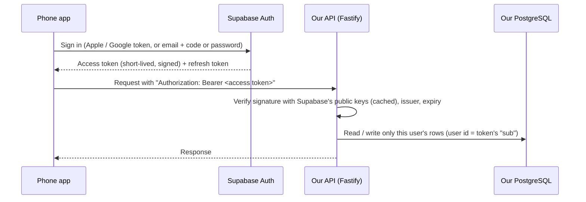

# Wildself — Sign-in with Supabase Auth

_As of 2026-11-24 · **Planned for Phase 1, not built** · Facts checked against Supabase's documentation and pricing page on 2026-11-24_

How sign-in works and every step to set it up: first the steps only you can do (accounts, dashboards, keys), then what I build in each Phase 1 stage. Decided with you on 2026-11-24 (FRONTEND.md §13.5, answers A1–A12).

**Related docs:** [POA.md](POA.md) (plan and progress) · [ARCHITECTURE.md](ARCHITECTURE.md) (backend) · [DB.md](DB.md) (database) · [FRONTEND.md](FRONTEND.md) (app) · [metrics_and_testing.md](metrics_and_testing.md) (metrics, tests, reports)

---

## 1. Decisions

| # | Decision |
| --- | --- |
| A1 | **Supabase Auth** handles sign-in. It is used **only** for sign-in. All app data stays in our own PostgreSQL behind our API |
| A2 | Sign in with **Apple**, **Google**, and **email** |
| A3 | **Email confirmation is required** for email-and-password accounts. _One point to confirm (§9)_ |
| A4 | Onboarding: name (required), avatar and height/weight (optional): 3 short steps |
| A5 | Avatar: chosen from a set of nature illustrations. **No profile photos:** Wildself is not a social network |
| A6 | Units follow the phone's region, with a switch in Settings |
| A7 | Location is asked for when first needed (Phase 11), not during onboarding |
| A8 | "13 or older" confirmation at sign-up; no birth date stored |
| A9 | Settings → Account → Delete account; confirm on a second screen, then delete everything immediately |
| A10 | Several devices allowed; stay signed in until you sign out |
| A11 | Welcome headline changes with the time of day (FRONTEND.md §13.5) |
| A12 | Terms and privacy links on the sign-up screen; documents written before launch (Phase 17) |

---

## 2. How it fits the architecture

- **Our server never sees a password.** Supabase stores passwords, sends codes and handles Apple and Google. Our database keeps no email or password, only the user's id, profile and app data.
- **Verification is local and fast.** Supabase signs access tokens with an asymmetric key (ES256). Our API checks each token with Supabase's **public** keys, which are fetched once and cached. So there is no call to Supabase per request, and a stolen public key is useless.
- **The secret key stays on the server.** It is needed only to delete an account in Supabase. It never goes in the app, git or chat.
- **The rate limits in our API** (120 per minute per user, or per IP before login) apply on top of Supabase's own sign-in limits.

---

## 3. Your steps: accounts, dashboards and keys

Do these in order. Each step says where any key or value goes. **Never paste the secret key or any password into chat.**

### Step 1 — Create the Supabase projects

1. Create an account at supabase.com and an organisation.
2. Create **two projects**: `wildself-staging` (for development and tests) and later `wildself-prod`.
   - **Region:** the one closest to your users. It should match where our API and database will be hosted, chosen in the deployment stage.
   - Use a strong database password and keep it in your password manager. We don't use the Supabase database, but the project needs one.
3. **Plan:**
   - Free plan: 50,000 monthly active users, but **free projects pause after 1 week of inactivity**, and the limit is 2 active projects.
   - Staging can stay free. **Production should be on Pro** (from $25/month, 100,000 monthly active users, then $0.00325 per user), because paid projects never pause.

### Step 2 — Use asymmetric signing keys (ES256)

1. In the project: **Project Settings → JWT Keys** (signing keys).
2. If the project still uses the legacy shared secret (HS256), choose **Migrate JWT secret**. Then create an **ES256** key, make it the current key, and later revoke the legacy secret.
3. **Why:** with asymmetric keys our API verifies tokens with public keys only. With the legacy shared secret, anyone holding it could create valid tokens.

### Step 3 — Create the API keys

1. Go to **Project Settings → API Keys**.
2. Create:
   - a **publishable key** (`sb_publishable_…`): goes in the app. It's public by design.
   - a **secret key** (`sb_secret_…`): server only, used for account deletion.
3. Once the new keys work, **disable the legacy `anon` and `service_role` keys.** Supabase is deprecating them by the end of 2026.
4. Where each value goes:

| Value | Where | Secret? |
| --- | --- | --- |
| Project URL (`https://<ref>.supabase.co`) | App config and server config | No |
| Publishable key | App config (`EXPO_PUBLIC_SUPABASE_KEY`) | No: it can only do what a signed-out visitor can |
| Secret key | `services/backend/.env` locally, and the host's secret store in staging and production (`SUPABASE_SECRET_KEY`) | **Yes: never in the app, git or chat** |

### Step 4 — Set up email sending (required)

Supabase's built-in email **only delivers to members of your Supabase team, about 2 emails per hour.** Real users get no codes without your own email service.

1. Use **a domain you own** (e.g. `wildself.app`), with a sending address such as `hello@` or `no-reply@`.
2. Choose an email service with SMTP (e.g. Resend, Postmark, Amazon SES). I can compare current prices when you're ready.
3. Add the **SPF, DKIM and DMARC** DNS records the service gives you. Without them, codes land in spam.
4. Enter the SMTP details in **Authentication → Emails → SMTP settings**. The SMTP password stays in the dashboard.
5. After saving, Supabase limits sending to **30 emails per hour** at first. Raise it in **Authentication → Rate Limits** as users grow.

### Step 5 — Email templates and code expiry

1. **Authentication → Emails → Templates:**
   - **Confirm signup:** show the 6-digit code `{{ .Token }}` instead of a link (see §9 for how sign-up works).
   - **Magic link:** show the code `{{ .Token }}`. This template is used for email one-time codes.
   - Write both in the app's voice: plain, calm, no exclamation marks (FRONTEND.md §11). I'll draft the text in the Phase 1 frontend stage.
2. **Email OTP expiration:** proposed **10 minutes**; the default is 1 hour. A user can request a new code once every 60 seconds.

### Step 6 — Email and password settings

1. **Authentication → Providers → Email:** **Confirm email ON** (your A3). It's on by default for hosted projects.
2. **Minimum password length:** proposed 10 characters.
3. **Leaked-password protection** blocks passwords known from data breaches. It's **Pro plan only**, so turn it on with the production project.

### Step 7 — Sign in with Apple

1. Join the **Apple Developer Program** ($99/year; needed to publish on the App Store anyway).
2. In Apple Developer → Identifiers, create the **App ID** with the app's bundle id (proposed `app.wildself`; it becomes permanent with the first store build). Turn on the **Sign in with Apple** capability.
3. In Supabase, go to **Authentication → Providers → Apple**: enable it, and in **Client IDs** add:
   - `app.wildself`, plus any development or preview bundle ids we create
   - `host.exp.Exponent`, so it can be tested in Expo Go
4. On iPhone, the app signs in natively. No Services ID or private key is needed.
5. **Android:** Apple has no native sign-in on Android. Offering it there needs Apple's web flow:
   - a **Services ID**
   - a return URL: `https://<ref>.supabase.co/auth/v1/callback`
   - a **.p8 key**, from which a client secret is made
   - the secret **expires every 6 months and must be renewed**

   See the question in §9.

### Step 8 — Sign in with Google

1. In **Google Cloud Console**, create a project. Set up the **OAuth consent screen**:
   - app name, support email, privacy policy link
   - scopes: `openid`, `email`, `profile`
2. Create **OAuth client IDs**:
   - a **Web** client: Supabase uses its id and secret
   - an **iOS** client: bundle id `app.wildself`
   - an **Android** client: package name `app.wildself`, plus the **SHA-1 fingerprint** of each signing key (development build, store build, and Google Play's app-signing key). EAS shows the first two; Play Console shows the third.
3. In Supabase, go to **Authentication → Providers → Google**: enable it, then:
   - enter the Web client secret
   - list **all client IDs, separated by commas, Web first**
   - enable **Skip nonce check** only if native sign-in fails without it (Supabase documents this for its native sample)

### Step 9 — Redirect URLs

1. Set **Authentication → URL Configuration → Site URL** to the website, once there is one.
2. Add the redirect URL **`wildself://auth/callback`**. The app's scheme `wildself` is already set in `app.json`. It's needed only for web-flow sign-ins (e.g. Apple on Android) and links in emails.

### Step 10 — Check the sign-in rate limits

In **Authentication → Rate Limits**, keep the defaults to start:

| Limit | Default |
| --- | --- |
| Sign-in and sign-up requests | 30 per 5 minutes per IP |
| One-time codes | 1 per user per 60 seconds |
| Code checks | 30 per 5 minutes per IP |
| Token refreshes and sign-ins with Apple or Google tokens | 150 per 5 minutes per IP |

### Step 11 — Hand over (safely)

1. **Send me in chat:** the project URL and the publishable key. Both are public by design.
2. **Don't send me the secret key.** Put it in `services/backend/.env` yourself as `SUPABASE_SECRET_KEY=` (git ignores this file), and later in the host's secret settings.
3. Tell me the bundle id and package name you want (proposed `app.wildself`), and whether Apple sign-in should appear on Android (§9).

---

## 4. What I build in Phase 1

### 4.1 Frontend stage

1. **Libraries**, installed with `npx expo install`:
   - `@supabase/supabase-js` and `react-native-url-polyfill`
   - session storage, **encrypted**: `expo-secure-store` holds a random AES-256 key; the session, encrypted with it, sits in `@react-native-async-storage/async-storage`, using `aes-js` and `react-native-get-random-values`. This is the "LargeSecureStore" pattern from Supabase's docs, needed because SecureStore holds at most 2 KB.
   - `expo-apple-authentication`
   - `@react-native-google-signin/google-signin`
2. **Client set-up:** `autoRefreshToken` on, `persistSession` on, `detectSessionInUrl` off. Token refresh pauses while the app is in the background.
3. **Screens:**
   - Welcome, with the time-of-day headline
   - Sign-in choices: Apple, Google, Email
   - Email: address, then a 6-digit code, or a password (§9). The code field uses the phone's one-time-code autofill.
   - Onboarding: name, then illustration avatar, then height and weight, with the 13+ confirmation and the terms and privacy links
   - Settings → Account: sign out, delete account
4. **Rules:**
   - Every form follows the keyboard rule (FRONTEND.md §7.4).
   - Every screen follows the 120 fps rule, light and dark, loading, empty and error states.
   - Errors in plain words, e.g. "That code has expired. We've sent a new one."

### 4.2 Backend stage

1. **New authenticator `supabase`:**
   - Verifies `Authorization: Bearer <token>` with `jose`, using `createRemoteJWKSet` on `https://<ref>.supabase.co/auth/v1/.well-known/jwks.json`.
   - Accepts **only ES256**, checks the **issuer** (`https://<ref>.supabase.co/auth/v1`), audience (`authenticated`, to be confirmed against a real token) and expiry. The user id is the `sub` claim.
   - Public keys are cached and refreshed when Supabase rotates them.
2. **Configuration:** `AUTH_MODE=supabase`, `SUPABASE_URL`, `SUPABASE_SECRET_KEY`. In production the server refuses to start without them, and still refuses `dev-stub`.
3. **Endpoints**, all idempotent, each checked to touch only the caller's own data:
   - `PUT /v1/me/profile`: creates or updates the profile (name, avatar, height, weight, units)
   - `GET /v1/me`: profile and onboarding state
   - `DELETE /v1/account`: deletes all our data for the user, then the Supabase user (with the secret key). It is safe to repeat if interrupted.
4. **Validation:** strict schemas (Zod) on every input; unknown fields rejected.

### 4.3 Database stage

- `users`: `id` (uuid, = Supabase `sub`, primary key) and `created_at`. **No email or password columns:** Supabase holds them, and we keep only what we use (data minimisation).
- `profiles`: `user_id` (primary key, references `users`, cascade delete), `display_name` (1–40 characters), `avatar_key` (one of the illustration ids), `height_cm` and `weight_kg` (optional, with sensible ranges), `unit_system` (`metric` or `imperial`).
- Deleting a user removes every row of theirs by cascade (DB.md).

### 4.4 Testing stage

- **Token tests:** valid; expired; wrong issuer; wrong algorithm (an HS256 token must be refused); tampered signature; missing `sub`.
- **Security tests per endpoint:** no login, another user's id, malformed input, oversized body, rate limit.
- **k6** on the profile endpoints. **Maestro** flows for each sign-in method on iOS and Android, with test accounts in the staging project.
- **Account deletion:** nothing of the user remains in our database or in Supabase.

---

## 5. Costs (checked 2026-11-24)

| Item | Cost |
| --- | --- |
| Supabase staging project | Free (pauses after 1 week without use) |
| Supabase production project | Pro, from $25/month; 100,000 monthly active users included, then $0.00325 each |
| Email service | Depends on the provider; most have a free tier for low volumes |
| Domain for email | About the price of a normal domain per year |
| Apple Developer Program | $99/year (needed for the App Store anyway) |
| Google Play developer account | One-time fee (needed for Google Play anyway) |

---

## 6. Things to know now

You asked to hear about difficulties immediately, so here they are, before any building:

1. **Google sign-in can't be tested in Expo Go.** Its library has native code that Expo Go doesn't include, so it needs a **development build** (EAS). That build is also needed to confirm 120 fps, so both happen in the Phase 0 deployment stage. Apple and email sign-in can be tested in Expo Go.
2. **Codes need your own email set-up** (Step 4). Without a domain and an email service, only your own team's addresses receive codes, about 2 per hour.
3. **Apple sign-in on Android** needs a secret that expires every 6 months (Step 7.5), or we show Apple only on iPhone (§9).
4. **Free Supabase projects pause** after a week without use, so production goes on Pro.
5. **Confirmation emails in a mobile app:** a link would have to open the app from the email, which is fragile. The plan uses a **6-digit confirmation code** instead (`verifyOtp` with type `signup`); this is checked when building.

---

## 7. Security checklist for this feature

- [ ] ES256 signing keys only; the legacy shared secret revoked
- [ ] Legacy `anon` / `service_role` keys disabled
- [ ] Secret key only on the server; a secret scan in CI confirms it is never in git
- [ ] Our API checks signature, algorithm, issuer, audience and expiry on every request
- [ ] Session stored encrypted on the phone
- [ ] Email confirmation on; password minimum length set; leaked-password protection on in production
- [ ] Custom SMTP with SPF, DKIM and DMARC
- [ ] Rate limits: Supabase's and ours (per user and per IP, before the login check)
- [ ] Account deletion removes everything, here and in Supabase

---

## 8. Where things live

| Thing | Where |
| --- | --- |
| Passwords, emails, Apple and Google identities | Supabase Auth only |
| User id | The token's `sub`; also the primary key of our `users` table |
| Name, avatar, height, weight, units | Our database (`profiles`) |
| Session on the phone | Encrypted with a key held in the iOS Keychain or Android Keystore (via expo-secure-store) |
| Secret key | Server environment only |

---

## 9. Still to confirm with you

1. **A3, email sign-in:** you chose the recommended one-time code (A2) and also said email confirmation is required for **email and password**. Which do you want?
   - **(a)** Email **and password**, confirmed with a code once at sign-up, replacing the one-time code, or
   - **(b)** **both**: a code by default, with an optional password.

   My recommendation is (a), for one clear way in. A forgotten password is reset with a code sent to the email.
2. **Apple sign-in on Android:** show it on Android too (needs the 6-month secret renewal), or Apple on iPhone only, with Google and email on both? My recommendation is **iPhone only**, which is what most apps do.
3. **Bundle id and package name:** proposed `app.wildself`.
