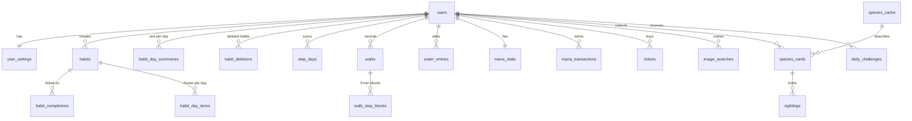

# Wildself — Database Design

_As of 2026-11-24 · Phase 0 database tooling built · No feature tables yet (they start in Phase 1)_

PostgreSQL holds the raw facts and the results the engines produce. It stores, retrieves, counts and sums, but never decides. Every read and write is a named function in the data layer, called only by the API. Engine work is read in batches of users and saved in one transaction per task. Detail is kept only while it is useful, then deleted.

**Related docs:** [POA.md](POA.md) (plan and progress) · [ARCHITECTURE.md](ARCHITECTURE.md) (backend) · [FRONTEND.md](FRONTEND.md) (app) · [IMPROVEMENTS_LOG.md](IMPROVEMENTS_LOG.md) (changes and instructions) · [metrics_and_testing.md](metrics_and_testing.md) (metrics, tests, reports)

> **Status (2026-11-24):** Phase 0 built the database tooling, not tables:
>
> - **`packages/data`:** connection pool (UTC, query timeouts on both ends, TLS required in production), health ping, and the worker leader lock.
> - **Migrations:** forward-only SQL files in `db/migrations` (`npm run db:migrate`), and a check that rejects any logic in a migration (`npm run db:check`, 12 tests).
> - **Local setup:** `db/local-setup.md`, which creates the `wildself_app` user (not a superuser) and the `wildself_dev` and `wildself_test` databases.
> - **Integration tests:** 6 tests that run on a real PostgreSQL. They refuse to run against any database whose name lacks "test". All 6 pass on your local PostgreSQL 17 (2026-11-24) and run in CI on PostgreSQL 17 on every push.
> - **Sign-in (Phase 1, planned):** Supabase Auth holds emails and passwords. Our `users` table keeps only the Supabase user id, and `profiles` keeps the name, illustration avatar, height, weight and units (AUTH.md §4.3).
>
> Table and column lists below are still drafts; each phase's migrations are written after its questions are answered. On the phone, Phase 0 stores only the theme choice and the offline action queue, in a local key-value store (not in this database).

---

## 1. Rules for the data layer

1. **Store, retrieve, count, sum. Never decide.** Queries may filter, join, group, count and sum. They may not contain app rules: no thresholds, mana constants, or `CASE` statements that encode rules (ARCHITECTURE.md §6.3).
2. **No logic objects in the database:** no stored functions, procedures, triggers, rules, scheduled jobs (`pg_cron`) or generated columns. CI rejects a migration that contains them.
3. **Batch reads:** every function an engine uses takes a list of users (proposed: up to 500).
4. **Atomic grouped writes:** every engine result is saved by one function that runs all its statements in **one transaction**.
5. **Integrity constraints are the last line of defence:** primary keys, foreign keys, `ON DELETE CASCADE` for records that belong to a parent, `NOT NULL`, `UNIQUE`, simple range `CHECK`s.
6. **Optimistic concurrency:** rows that several writers can touch (e.g. `mana_state`) carry a `version`.
7. **Only the API calls the data layer.**
8. **Time:** moments are stored as `timestamptz` in UTC; anything that belongs to a user's day also stores `local_date`. Time-zone arithmetic happens in engines, never in SQL.
9. **Keep only what is used.** A column or row is stored only if a feature reads it. Detail that stops being useful is deleted on a schedule (§10.3).
10. **Defaults only for bookkeeping times:** `now()` for moments that simply mean "when this row was written". Everything with meaning comes from the API (§2).

---

## 2. Who supplies each value

**Rule:** `now()` is used when the moment the database writes the row *is* the meaning. The API supplies the value when it describes something that happened elsewhere (on the phone, in the user's day), when an engine calculated it, or when the same value must be shared by several rows in one transaction.

| Value | Supplied by | Why |
| --- | --- | --- |
| `created_at`, `updated_at` | `now()` | Bookkeeping |
| `received_at` (when an action reached the server) | `now()` | The write moment is the meaning |
| `deleted_at` (habit deletions), `synced_at` (steps), `purchased_at` (tickets), `saved_at` (bookmarks) | `now()` | The moment of the request is enough |
| `closed_at`, `amended_at` (day summaries), `finished_at` (engine runs) | `now()` | Bookkeeping |
| **Primary keys (`id`)** | API (UUIDv7) | An engine needs ids before writing, e.g. a new card's id used by its sighting in the same transaction. Time-ordered ids also keep indexes compact |
| `client_action_id` | Phone | Makes a resent offline action unique |
| `device_completed_at`, `device_sent_at` | Phone | Happened on the phone |
| `logged_at` (water), `started_at` / `stopped_at` (walks), `taken_at` (photos) | Phone | When the user actually did it, even offline |
| `local_date` (every table) | Phone or engine | The user's own day in their time zone; the database never computes time zones |
| `completed_at` (corrected tick time), `ended_at` (trimmed walk) | Engine | Calculated |
| `issued_at`, `expires_at` (daily challenges) | Engine | Expiry is a rule (24 hours unless saved) |
| `amount`, `base`, `multiplier`, `price` | Engine | Calculated |
| `version` | Engine via API | The concurrency check |
| Setting defaults (e.g. end-of-day reminder on) | API | Product rules, not database defaults |
| `started_at` (engine runs) | Engine | When the engine began, which is earlier than the write |

---

## 3. Entity overview

---

## 4. Habit tables (Phases 2–3)

### 4.1 `habits` — recording

| Column | Type | Rule |
| --- | --- | --- |
| `id` | uuid | Primary key (API) |
| `user_id` | uuid | FK → users, not null |
| `title` | text | Not null, 1–60 characters |
| `description` | text | Optional |
| `icon` | text | Not null |
| `schedule_preset` | text | `all_days`, `except_sunday` or `custom` |
| `schedule_days` | smallint | 1–127. One bit per weekday: Monday = 1 … Sunday = 64. All days = 127; except Sunday = 63 |
| `window_start`, `window_end` | time | Optional; both set or both empty; end later than start |
| `sort_order` | integer | Position in the habits box |
| `created_at`, `updated_at` | timestamptz | `now()` |

Index: `(user_id)`.

### 4.2 `habit_completions` — recording, kept 30 days

One row means "this habit was ticked on this local date". Untick deletes the row. After 30 days the row is deleted; the frozen day records keep the history.

| Column | Type | Rule |
| --- | --- | --- |
| `id` | uuid | Primary key (API) |
| `user_id` | uuid | FK → users |
| `habit_id` | uuid | FK → habits, `ON DELETE CASCADE` |
| `local_date` | date | The day the tap belongs to |
| `client_action_id` | uuid | Phone-generated; a resent action is never saved twice |
| `device_completed_at` | timestamptz | When the tap happened, by the phone's clock |
| `device_sent_at` | timestamptz | The phone's clock when it sent the action |
| `received_at` | timestamptz | `now()` |
| `completed_at` | timestamptz | Corrected tap time, set by the Habit tracker engine |

Unique: `(habit_id, local_date)`, `(client_action_id, local_date)`. Index: `(user_id, local_date)`. Partitioned by month.

### 4.3 `habit_day_summaries` — Habit tracker engine

The frozen record of each user-day. No foreign key to `habits`, so deleting a habit never rewrites past days. Its existence marks the day as closed.

| Column | Type | Rule |
| --- | --- | --- |
| `user_id`, `local_date` | uuid, date | Primary key |
| `scheduled_count` | smallint | Habits scheduled that day |
| `completed_count` | smallint | Of those, completed |
| `status` | text | `complete`, `missed`, `covered` (a ticket was used), `nothing_scheduled` |
| `revision` | smallint | 1 at the midnight close; +1 for each late amendment |
| `closed_at`, `amended_at` | timestamptz | `now()` |

### 4.4 `habit_day_items` — Habit tracker engine

Per-habit history for weekly and monthly charts. Only scheduled habits get a row.

| Column | Type | Rule |
| --- | --- | --- |
| `habit_id`, `local_date` | uuid, date | Primary key; `habit_id` FK → habits, `ON DELETE CASCADE` |
| `user_id` | uuid | FK → users |
| `completed` | boolean | Not null |

Index: `(user_id, local_date)`. Partitioned by month.

### 4.5 `habit_deletions` — recording, on delete

Only what is needed: the count of deleted habits per period, and the fixed mana penalty. No foreign key to `habits`, so the cascade that removes the habit and its history leaves this row in place.

| Column | Type | Rule |
| --- | --- | --- |
| `id` | uuid | Primary key (API) |
| `user_id` | uuid | FK → users |
| `habit_id` | uuid | The deleted habit's id; unique, so a habit can only be recorded as deleted once |
| `habit_created_at` | timestamptz | Lets Analytics still count "habits created this month" after a deletion |
| `deleted_at` | timestamptz | `now()` |
| `penalty_applied_at` | timestamptz | Set when the Mana engine applies the fixed penalty |

Index: `(user_id, deleted_at)`; partial index on rows where `penalty_applied_at` is empty.

### 4.6 `user_settings` — recording

| Column | Type | Rule |
| --- | --- | --- |
| `user_id` | uuid | Primary key, FK → users |
| `time_zone` | text | The phone's **current** time zone (IANA name), updated whenever the phone reports a change. Indexed; used to find users at midnight |
| `last_seen_at` | timestamptz | `now()` each time the app opens; used to find dormant users |
| `theme` | text | `light`, `dark` or `system` |
| `haptics_on`, `sounds_on`, `eod_reminder_on` | boolean | Defaults set by the API |
| `eod_reminder_time` | time | Default to be decided |
| `step_goal` | integer | Optional |
| `water_goal_glasses` | smallint | Optional |

---

## 5. Step and water tables (Phases 4–5)

| Table | Written by | Columns | Key constraints · retention |
| --- | --- | --- | --- |
| `step_days` | Recording (phone sync, same day) | `user_id`, `local_date`, `steps`, `synced_at` | PK (user, date); a later sync replaces the count |
| `walks` | Recording (Start / Stop on the Steps tile) + Step tracker engine | `id`, `user_id`, `local_date`, `started_at`, `stopped_at`, `ended_at` (engine), `steps`, `status` | Index (user, date) |
| `walk_step_blocks` | Recording (phone sync) | `walk_id`, `block_start` (5-minute block), `steps` | PK (walk, block), FK cascade · **deleted after 7 days** |
| `step_day_summaries` | Step tracker engine | `user_id`, `local_date`, `steps`, `goal_met`, `distance_m`, `kcal` | PK (user, date) |
| `water_entries` | Recording | `id`, `user_id`, `local_date`, `client_action_id`, `logged_at` (one row per glass) | Index (user, date) · **deleted after 30 days** · partitioned by month |
| `water_day_summaries` | Water tracker engine | `user_id`, `local_date`, `glasses`, `goal_met` | PK (user, date) |

---

## 6. Mana, tickets and engine bookkeeping (Phases 6–7)

| Table | Columns | Key constraints · retention |
| --- | --- | --- |
| `mana_state` | `user_id`, `balance`, `lifetime_earned`, `level`, `streak_days`, `multiplier`, `last_closed_date`, `version` | PK user; `version` for optimistic concurrency. Balance and lifetime earned are separate so that spending mana on tickets need not lower the level (ARCHITECTURE.md §11.8) |
| `mana_transactions` | `id`, `user_id`, `local_date`, `source` (`daily_habits`, `habit_deleted`, `steps`, `water`, `ticket`, `daily_challenge`, `monthly_bonus`, `correction`), `source_id`, `base`, `multiplier`, `amount`, `idempotency_key`, `created_at` | Unique `idempotency_key`; append-only; **no row when the amount is 0**; partitioned by month |
| `tickets` | `id`, `user_id`, `price`, `purchased_at`, `status` (`held`, `used`, `expired`), `used_for_date` | Unique (user, `used_for_date`) so one day can't take two tickets; index (user, status). Rules still to be set |
| `level_thresholds` | `level`, `mana_required`, `tier_title` | 150 rows, seeded |
| `engine_runs` | `engine`, `user_id`, `scope_key` (e.g. `day:2026-11-23`), `status`, `started_at`, `finished_at`, `error` | Unique (engine, user, scope key) · **deleted after 90 days** · partitioned by month |

---

## 7. Other tables (summary)

| Table | Phase | Holds | Written by | Key constraints · retention |
| --- | --- | --- | --- | --- |
| `users` | 1 | Account: `id` = the Supabase user id (`sub`), `created_at`. **No email or password**: Supabase Auth holds them (AUTH.md) | Recording | PK on the Supabase id; deleting cascades to everything the user owns |
| `profiles` | 1 | Display name (1–40 characters), illustration avatar key (no photos), height and weight (optional, with sensible ranges), unit system (`metric` / `imperial`) | Recording | 1 per user; avatar key must be one of the illustration set |
| `image_searches` | 9 | Photo path, photo hash, taken at, status, result species, confidence | Recording + Image search engine | Unique (user, photo hash) |
| `species_cache` | 9 | Taxon id, scientific name, group, common names by language, English description, image links, sources | Image search engine | Unique taxon id; shared by all users |
| `species_cards` | 9 | A user's card for one species, first-seen date and place | Image search engine | Unique (user, taxon) |
| `sightings` | 9 | Each photo on a card: path, ThumbHash, date, time, place **rounded to about 500 m on the phone before upload** | Image search engine | FK to card and search. Photos stored as WebP at 1280 px; location data removed from the image file before upload |
| `learning_events` | 10 | What counts as "learned" (to define) | To define | — |
| `daily_challenges` | 11 | Target species, area, season, issued / expiry, saved, completed, completing sighting | Challenge logic (owner to decide) | Unique (user, local date) |
| `challenge_pool` | 11 | Species recorded per area and month | Challenge logic | Unique (area, month, taxon) |
| `analytics_snapshots` | 12 | Results per user, category, period | Analytics engine | Unique (user, category, period) · weekly ones **deleted after 90 days**, monthly kept |
| `achievements`, `user_achievements` | 12 | Catalogue and unlocks | Config / Analytics engine | Unique (user, achievement) |
| `journal_secrets`, `journal_entries` | 13 | Journal lock and entries | Recording | 1 secret row per user |
| `special_challenges` | 15 | Offer, accepted / declined, custom goal, dates | Recording | — |
| `rewards`, `user_rewards` | 16 | Catalogue, unlocks, generated calendar files | To decide | Unique (user, reward) |

---

## 8. Data-layer operations

Reads used by engines take a batch of users. Writes marked **(tx)** run all their statements in one transaction.

### 8.1 Recording (public API)

| Operation | Does |
| --- | --- |
| `createHabit`, `updateHabit`, `readHabit`, `listHabits(userId)` | Habit CRUD |
| `deleteHabit(habitId)` **(tx)** | Write `habit_deletions`, then delete the habit; its completions and day items go with it by cascade |
| `createCompletion`, `deleteCompletion` | Tick and untick, with phone timestamps and action id; if the day is closed, the API passes the action to the Habit tracker engine instead |
| `upsertStepDay`, `createWalk`, `stopWalk`, `upsertWalkStepBlocks` | Steps and walks |
| `createWaterEntry`, `deleteWaterEntry` (if allowed) | Water |
| `saveChallenge`, `unsaveChallenge`, `listSavedChallenges` | Bookmarks |
| `requestTicketPurchase`, `requestTicketUse` | Hand the request to the engines (rules to be set) |
| `readUserSettings`, `updateUserSettings`, `touchLastSeen(userId, timeZone)` | Settings, current time zone, last seen |

### 8.2 Midnight pipeline (internal API)

| Operation | Reads or writes |
| --- | --- |
| `listUsersToClose(timeZones[], localDate, seenAfter)` | Users in those zones, seen after the dormancy cut-off the engine passes in, whose day is not yet closed |
| `readHabitDayInputs(userIds[], fromDate, toDate)` | Habits, completions and tickets for the batch; a range, so returning dormant users can be caught up |
| `saveHabitDayResults([...])` **(tx)** | Day summaries + day items + engine runs |
| `saveAmendedDays([...])` **(tx)** | Late completions or removals + summary revisions + day items + engine runs |
| `readStepDayInputs` / `saveStepDayResults` **(tx)** | Step days, walks and blocks → step summaries, trimmed walks, engine runs |
| `readWaterDayInputs` / `saveWaterDayResults` **(tx)** | Glasses counted per user → water summaries, engine runs |
| `readManaInputs(userIds[], fromDate, toDate)` | Day summaries (habit, step, water), mana states with versions, pending penalties, tickets |
| `applyManaResults([...])` **(tx)** | Mana transactions + mana states (only if the version is unchanged) + penalties marked applied + tickets settled + engine runs |

### 8.3 Other engines and maintenance

| Operation | Reads or writes |
| --- | --- |
| `readSearchInputs` / `saveSearchResult` **(tx)** | Image search: cache, card, sighting, challenge completion, search status |
| `readAnalyticsInputs` / `saveAnalyticsResults` **(tx)** | Counts and sums per period → snapshots and achievements |
| `deleteExpired(table, before)` | Nightly retention run by the worker (§10.3); partitioned tables drop whole months |

---

## 9. Migrations

- **Tool (chosen 2026-11-24):** `node-pg-migrate` 9 with plain SQL files in `db/migrations` (`npm run db:new <name>` creates one). Run only through `npm run db:migrate`, which runs the no-logic check first, refuses `down` (forward-only), checks migration order and takes PostgreSQL's migration lock so two deploys never migrate at once. Its `pg` driver is used for migrations only; the app uses `postgres.js`.
- **Coordination, not logic:** the worker's single-leader lock uses PostgreSQL's built-in `pg_try_advisory_lock`, a coordination primitive with no business rules (ARCHITECTURE.md §8.1).
- **One migration per change**, named `YYYYMMDDHHMM_short_description.sql`, each with a rollback note.
- **CI checks** (`db/tools/check-migrations.mjs`, built 2026-11-24): fails on stored functions, procedures, triggers (including constraint and event triggers), rules, `DO` blocks, procedural languages, `pg_cron` and generated columns; comments are ignored. Every migration is applied to a fresh database and to a copy of staging.
- **Partitioned tables** (`habit_completions`, `habit_day_items`, `water_entries`, `mana_transactions`, `engine_runs`) are split by month. Their unique keys include the partition column. The worker creates next month's partitions in advance.
- **Changes to live tables** follow expand → migrate → contract.
- **Seed data:** level thresholds, achievement catalogue, sample habits.
- Every batch read is checked with `EXPLAIN` against 100,000 seeded users before its phase ships.

---

## 10. Data growth

Estimates for planning; real sizes are measured in Phase 3 on seeded data.

### 10.1 Before the cuts: one active user, one day

5 habits scheduled, 4 ticked · 1 step sync · 1 walk every 2 days · 6 glasses · 1 daily challenge · 1 photo and 1 journal entry every 3 days.

| Data | Rows per day | Bytes per day |
| --- | --- | --- |
| Habit ticks | 4 | 1,200 |
| Frozen day records | 6 | 870 |
| Engine run markers | 4 | 680 |
| Mana transactions | ~1.5 | 480 |
| Steps and walks | ~2.5 | 325 |
| Water | 7 | 1,490 |
| Daily challenge | 1 | 220 |
| Image searches, sightings, cards | ~0.7 | 215 |
| Analytics snapshots | ~0.7 | 500 |
| Journal entries | ~0.3 | 450 |
| **Total** | **~28** | **~6.4 KB**, about **8 KB** with PostgreSQL overhead |

Photos: about 400 KB each, about 120 KB per user per day.

### 10.2 After the cuts (all adopted 2026-11-23)

About **3 KB per active user per day** kept long-term (about 1.2 MB a year), and about **18 MB of photos per user per year**.

| Daily active users | Database per year | Photos per year |
| --- | --- | --- |
| 10,000 | ~12 GB | ~180 GB |
| 100,000 | ~120 GB | ~1.8 TB |
| 1,000,000 | ~1.2 TB | ~18 TB |

Query speed does not depend on how much history exists: every query reads one user's date range through an index.

### 10.3 Retention and size rules (adopted)

| Data | Kept for | What stays afterwards |
| --- | --- | --- |
| `habit_completions` | 30 days | Frozen day summaries and per-habit day records |
| `water_entries` (single glasses) | 30 days | Water day summaries |
| `walk_step_blocks` | 7 days | Trimmed walks |
| `engine_runs` | 90 days | Frozen day summaries |
| Weekly `analytics_snapshots` | 90 days | Monthly snapshots |
| Mana transactions of 0 | Never written | Mana state |
| Photos | Forever, as WebP 1280 px + thumbnail | — |
| Dormant users (14 days without opening the app) | Midnight pipeline pauses | On return, the missed days are closed as **missed** in one batch |

---

## 11. Open questions

1. **Mana precision:** decimals or whole numbers? (Decided later, with the Mana engine.)
2. ~~Rounding photo locations~~ Answered: on the phone, before upload.
3. **Crossing the date line (deferred):** your stance is that habits are ultimate, so users plan date-line travel themselves, for example with a ticket. Detailed handling of a skipped calendar date is decided later, with the Mana engine.
